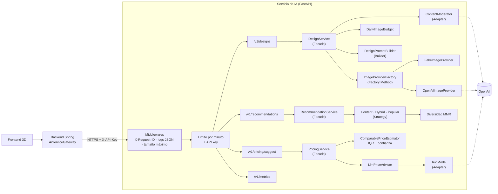

# MUSEO — Servicio de IA

[](https://github.com/Luisaparrac/BarnizGallery-IA/actions/workflows/ci.yml)

Servicio de inteligencia artificial de **MUSEO**, la galería 3D y tienda del Barniz de Pasto
Mopa-Mopa. Proyecto final del curso *Patrones de Software* (Universidad Cooperativa de Colombia).

- Solo lo llama el backend; el frontend nunca habla con este servicio.
- No tiene estado ni base de datos: recibe en el JSON lo que necesita y responde.
- Todas las rutas, menos `/health`, piden el header `X-API-Key: <AI_SERVICE_KEY>`.
- Los errores tienen siempre la forma `{"code": "...", "message": "..."}`.

## Arquitectura



## Funciones

| Ruta | Qué hace |
|---|---|
| `GET /health` | Estado, versión, proveedores activos y commit desplegado (sin clave). |
| `POST /v1/designs` | Imágenes de propuesta para un encargo (simuladas u OpenAI). |
| `POST /v1/recommendations` | Ordena obras según los gustos del cliente, con explicación en español. |
| `POST /v1/pricing/suggest` | Sugiere un precio a partir de piezas comparables, con nivel de confianza. |
| `GET /v1/metrics` | Contadores por ruta, latencia, imágenes del día y costo estimado. |

Las recomendaciones y el precio usan **códigos de texto** (`"rojo"`, `"colibri"`, `"bandeja"`)
y no ids, para funcionar con los tags actuales del backend y con los catálogos de la v2.
Los códigos se normalizan: `"Colibrí"` y `"colibri"` son lo mismo.

La guía para el backend está en [`docs/integracion-backend.md`](docs/integracion-backend.md) y
los cambios de cada versión en [`CHANGELOG.md`](CHANGELOG.md).

## Requisitos

- Python 3.12 o superior.
- Una clave de OpenAI solo si se activa un proveedor `openai`.

## Cómo correrlo en local

```bash
python -m venv .venv
# Windows: .venv\Scripts\activate    Linux/macOS: source .venv/bin/activate
pip install -r requirements-dev.txt

cp .env.example .env    # y llena AI_SERVICE_KEY (y OPENAI_API_KEY si la usas)
uvicorn app.main:app --reload
```

- Documentación interactiva con ejemplos: <http://localhost:8000/docs>
- Prueba rápida: `curl http://localhost:8000/health`

Con `IMAGE_PROVIDER=fake` y `TEXT_PROVIDER=none` (valores por defecto) el servicio **no gasta
nada**: las imágenes las dibuja Pillow y el precio sale solo de los comparables.

## Protección del saldo

| Protección | Cómo | Respuesta |
|---|---|---|
| Límite diario de imágenes | `DAILY_IMAGE_LIMIT` imágenes pagas por día (hora de Colombia). Si una generación falla, la imagen no cuenta. | `429 budget_exceeded` + `Retry-After` |
| Solicitudes por minuto | `RATE_LIMIT_PER_MINUTE` por clave e IP, ventana deslizante de 60 s. Cuenta también los intentos con clave equivocada. | `429 rate_limited` + `Retry-After` |
| Moderación | Con OpenAI, el texto del cliente pasa por el endpoint de moderación **antes** de pagar la imagen. | `400 content_rejected` |
| Tamaño del cuerpo | `MAX_REQUEST_BYTES` (1 MB). | `413 invalid_request` |

> Los contadores viven en memoria: se reinician cuando Render reinicia o despierta el servicio.
> Configura también un **límite de gasto en el proyecto de OpenAI**.

## Observabilidad

- **Logs en JSON** (una línea por evento) con `request_id`, ruta, estado, duración, proveedor,
  modelo y código de error. **Nunca** se registran claves, headers, cuerpos, prompts ni datos
  del cliente; las excepciones se registran sin su mensaje.
- **`X-Request-ID`**: si el backend lo envía (hasta 64 caracteres `A-Z a-z 0-9 . _ -`) se
  reutiliza; si no, se genera. Siempre se devuelve en la respuesta y aparece en cada log.
- **`GET /v1/metrics`**: contadores, errores por código y latencia promedio por ruta; imágenes
  del día por proveedor, tokens de texto y **costo estimado** con los precios configurados.

## Variables de entorno

| Variable | Uso | Por defecto |
|---|---|---|
| `AI_SERVICE_KEY` | Clave que debe enviar el backend | (obligatoria) |
| `IMAGE_PROVIDER` | `fake` u `openai` | `fake` |
| `OPENAI_API_KEY` | Clave de OpenAI | vacía |
| `OPENAI_IMAGE_MODEL` | Modelo de imágenes | `gpt-image-2` |
| `OPENAI_IMAGE_QUALITY` | `low`, `medium` o `high` | `medium` |
| `OPENAI_IMAGE_SIZE` | Tamaño de la imagen | `1024x1024` |
| `OPENAI_IMAGE_FORMAT` | `webp`, `jpeg` o `png` | `webp` |
| `OPENAI_IMAGE_COMPRESSION` | Calidad 0–100 para webp/jpeg | `80` |
| `MODERATION_ENABLED` | Moderar el texto antes de generar (solo con OpenAI) | `true` |
| `OPENAI_MODERATION_MODEL` | Modelo de moderación | `omni-moderation-latest` |
| `TEXT_PROVIDER` | `none` u `openai` (precio sugerido) | `none` |
| `OPENAI_TEXT_MODEL` | Modelo de texto | `gpt-6-luna` en `.env.example` |
| `PROVIDER_TIMEOUT_SECONDS` | Espera máxima a OpenAI para imágenes | `90` |
| `MAX_IMAGES_PER_REQUEST` | Imágenes por llamada | `2` |
| `DAILY_IMAGE_LIMIT` | Imágenes pagas por día | `30` |
| `RATE_LIMIT_PER_MINUTE` | Solicitudes por minuto por clave e IP | `20` |
| `MAX_REQUEST_BYTES` | Tamaño máximo del cuerpo | `1000000` |
| `RECO_WEIGHT_COLOR` / `_SHAPE` / `_STYLE` / `_MOTIF` | Pesos de la similitud | `1.0` / `1.5` / `1.2` / `1.3` |
| `RECO_BUDGET_SHARE` | Peso del presupuesto en el puntaje (0–1) | `0.15` |
| `RECO_PROFILE_SHARE` | Peso del perfil frente a las interacciones (0–1) | `0.6` |
| `RECO_DIVERSITY` | Diversidad por taller con MMR (0 = sin diversidad) | `0.3` |
| `OPENAI_IMAGE_COST_USD` | Precio por imagen para el costo estimado | `0.053` |
| `OPENAI_TEXT_INPUT_USD_PER_MTOK` / `_OUTPUT_` | Precio por millón de tokens de texto | `0.10` / `0.50` |
| `DOCS_ENABLED` | Mostrar `/docs`, `/redoc` y `/openapi.json` | `true` |
| `LOG_LEVEL` | `DEBUG`, `INFO`, `WARNING` o `ERROR` | `INFO` |

El archivo `.env` nunca se sube al repositorio; está en `.gitignore`.

## Pruebas y linter

```bash
pytest
ruff check .
pip-audit -r requirements.txt   # vulnerabilidades conocidas en las dependencias
```

GitHub Actions (`.github/workflows/ci.yml`) corre lo mismo en cada push y pull request; en
`main` revisa cada commit, porque Render despliega cada push.

Las pruebas **nunca llaman a OpenAI**: usan el proveedor simulado o mocks, y arman la
configuración en memoria (no leen tu `.env`).

## Patrones de diseño

| Patrón | Dónde | Para qué |
|---|---|---|
| Singleton | `Settings` con `lru_cache` (`app/core/config.py`) | Leer la configuración una sola vez. |
| Adapter | `ImageProvider`, `TextModel` y `ContentModerator` (OpenAI y alternativas) | Que los servicios no dependan del SDK de OpenAI. |
| Null Object | `DisabledTextModel`, `NoopContentModerator` | Funcionar sin OpenAI sin preguntar por `None`. |
| Factory Method | `ImageProviderFactory` | Elegir el proveedor según `IMAGE_PROVIDER`. |
| Builder | `DesignPromptBuilder` (y `for_request` como director) | Armar el prompt paso a paso, con composición por imagen. |
| Strategy | `ContentBasedStrategy`, `HybridStrategy`, `PopularityStrategy` | Cambiar el algoritmo de recomendación según los datos. |
| Template Method | `RecommendationStrategy.rank` | Cada estrategia solo define su vector de gustos; el resto se comparte. |
| Facade | `DesignService`, `RecommendationService`, `PricingService` | Que las rutas no conozcan proveedores ni estrategias. |
| Chain of Responsibility | Middlewares ASGI y dependencias de `/v1` | Request ID → logs → tamaño → límite → clave → ruta. |

## Recomendaciones

**¿Por qué no se entrenan?** MUSEO tiene todavía **muy pocos datos reales** (pocas obras,
clientes e interacciones). Un modelo entrenado con tan pocos datos se sobreajusta. Por eso se usa
**similitud por contenido**: obras y perfiles son vectores de colores, forma, estilo y figuras,
comparados con similitud coseno ponderada (pesos configurables), más un ajuste por presupuesto.

- **Híbrida:** suma el gusto que se deduce de las interacciones (ver según la duración, acercar,
  favorito, carrito, compra, compartir, contactar).
- **Diversidad (MMR):** evita que un solo taller llene la lista; una pieza casi igual de buena de
  otro taller sube antes que una tercera copia del mismo taller.
- **Explicación:** cada resultado trae `reasons` y una frase corta en español.
- **Calidad medida:** `tests/test_recommendation_quality.py` usa un catálogo sintético de 80
  piezas y mide NDCG@10, el efecto de las interacciones y del presupuesto, la diversidad, la
  monotonía y el determinismo.

## Precio sugerido

El precio es una **sugerencia** para el artesano; él decide.

1. Se descartan los **precios atípicos** con la regla del rango intercuartílico (IQR).
2. Se calcula la mediana ponderada por parecido (forma, figuras, tamaño; las vendidas pesan más)
   y el rango entre los percentiles 25 y 75.
3. `confidence` es `high`, `medium` o `low` según cuántos comparables hay y qué tan parecidos son.
4. Si hay modelo de texto, ajusta **dentro del rango** y redacta la explicación.

Con menos de 3 comparables, haya o no modelo de texto, responde `422 not_enough_data`:
**nunca inventa un precio**.

## Despliegue en Render (Docker)

1. En Render, crea un **Web Service** desde este repositorio con entorno **Docker**, rama `main`
   y *Auto-Deploy* activado.
2. En *Environment* agrega las variables de la tabla (como mínimo `AI_SERVICE_KEY`). En
   producción conviene `DOCS_ENABLED=false`.
3. *Health check path*: `/health`. El campo `commit` muestra qué commit está desplegado
   (Render lo pone solo en la variable `RENDER_GIT_COMMIT`).
4. Render inyecta la variable `PORT`; el `Dockerfile` ya la usa.
5. En el backend configura `AI_SERVICE_URL` (la URL de Render) y la misma `AI_SERVICE_KEY`.

### Probar el despliegue (smoke test)

```bash
# Linux/macOS
AI_SERVICE_KEY=<clave> python scripts/smoke_test.py
# Windows PowerShell
$env:AI_SERVICE_KEY="<clave>"; python scripts/smoke_test.py
```

Revisa `/health`, que `/v1` rechace las llamadas sin clave, las recomendaciones y el precio
sugerido contra Render (o contra `AI_SERVICE_URL`). **No genera imágenes**, así que no gasta.
La clave se lee del entorno y nunca se imprime; el código de salida es 0 si todo pasa.

> **Ojo con el plan gratis:** Render "duerme" el servicio tras unos 15 minutos sin uso y la
> primera llamada después puede tardar cerca de un minuto en responder mientras arranca. El
> backend debe tener timeouts generosos (120 s para diseños) y seguir funcionando con sus reglas
> fijas si la IA no responde. Al despertar se reinician los contadores en memoria.
